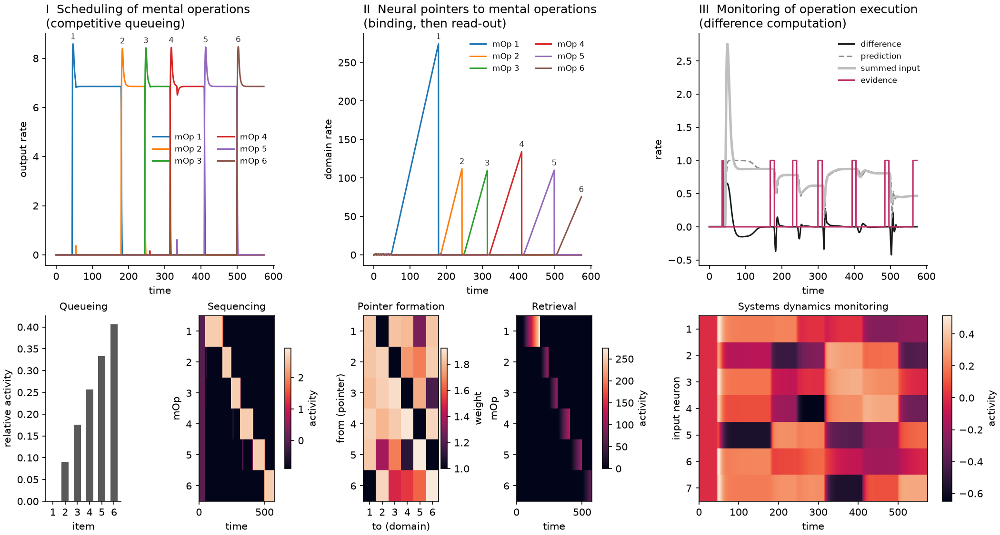

# Neural Pointers

Neurodynamical (rate-based) models for sequencing and executing visual-mental operations, accompanying the poster

> D. Schmid, C. Jarvers, H. Neumann. *A Neurodynamical Model of Sequencing and Executing Visual-Mental Operations.*
> Poster presented at the [7th BonnBrain³ Meeting](https://bonnbrain.de/7th-bonnbrain-meeting-19-21-08-2024-venusberg-campus-bonn-germany/),
> 19–21 August 2024, Bonn, Germany.

Solving demanding perceptual tasks requires the brain to compose mental operations into routines and to execute them
in a context-dependent order. This repository contains three model components that address parts of this problem:

| Component | Package | What it does |
|---|---|---|
| Synaptic neural pointers | `neural_pointers.pointers` | Pointer neurons are bound to patterns of domain activity by fast Hebbian plasticity and later re-instantiate the bound pattern via winner-take-all read-out (after Zylberberg et al., 2013). |
| Competitive queueing | `neural_pointers.competitive_queueing` | A graded activity pattern is executed item by item, gated by an arousal signal (after Boardman & Bullock, 1991). |
| Difference computation | `neural_pointers.difference_computation` | A monitoring network accumulates evidence and signals when an input representation has settled, i.e. when an operation has finished. |

All models are systems of ordinary differential equations integrated with `scipy.integrate.odeint`. A simulation is a
sequence of *stages* (e.g. binding, reset, read-out), each with its own external inputs. The equations are documented
in the docstrings of the model classes.

The three components are simulated independently. Their stage durations are aligned so that they jointly depict one
sequence of six operations. A coupled simulation is not part of this release yet.

## Results



The default simulations, arranged like the results panel of the poster (generated with `python plot_overview.py`):

* **I Competitive queueing.** Top: output rates of six mental operations (mOps) that are executed one after another
  whenever the arousal signal is on. Bottom: normalized activity of the input (planning) layer at the end of the
  simulation (*Queueing*) and output activity over time, with operations in order of execution (*Sequencing*).
* **II Neural pointers.** Top: domain rates. In the first 44 time units, six input patterns are bound to six pointers
  (small activity at the start); afterwards each pointer is activated in turn and its bound pattern wins the read-out
  competition. Bottom: pointer-to-domain weights after binding (*Pointer formation*) and domain activity over time
  (*Retrieval*).
* **III Monitoring.** Top: the difference between the summed input and its prediction. The evidence neuron signals
  that the input representation has settled after each change of the input pattern. Bottom: activity of the input
  neurons over time (*Systems dynamics monitoring*).

## Installation

Python 3.10 or newer is required.

```bash
git clone <repository-url> neural-pointers
cd neural-pointers
pip install -e .
```

To use the exact package versions the reproduction tests were run with, install `pip install -r requirements.txt -e .`
instead.

## Usage

Each component has its own entry point and [Hydra](https://hydra.cc) configuration in `configs/<component>/`:

```bash
python run_pointers.py
python run_competitive_queueing.py
python run_difference_computation.py
```

Every run stores its resolved configuration, a log, `results.npz` (time points `t`, states `h`, `stage_names` and
`stage_lengths`; additionally `convergence_times` for the difference computation) and figures in
`outputs/<component>/<date>/<time>/`.

Parameters can be overridden on the command line, and parameter sweeps run with `--multirun`, e.g.

```bash
python run_pointers.py plot=false model.WTA_params.neuron_params.delta=5.0
python run_pointers.py --multirun seed=1,2,3 plot=false
```

Each configuration consists of the top-level `config.yaml` (seed, number of neurons, plotting), `model/` (model
parameters) and `simulation/` (time step and stage protocol). To define a new protocol, add a file to `simulation/`
and select it with `simulation=<name>`. The available stage names are listed in the respective `inputs.py`.

The components can also be used from Python:

```python
from hydra import compose, initialize_config_dir
from neural_pointers.pointers.experiment import run_experiment

with initialize_config_dir(version_base="1.3", config_dir="/abs/path/to/configs/pointers"):
    cfg = compose(config_name="config")
model, results = run_experiment(cfg)  # list of StageResult(name, t, h)
```

## Reproducing the poster

The default configurations reproduce the simulations shown on the poster. The tests check this against stored
reference trajectories:

```bash
pip install -e ".[dev]"
pytest
```

## Known issues

Several differences between the underlying concept and the implementation, as well as bugs that affect the
dynamics, are kept for now to preserve reproducibility. They are listed in
[docs/known_issues.md](docs/known_issues.md).

## Repository layout

```
configs/                 Hydra configurations, one directory per component
neural_pointers/
  activations.py         activation functions shared by all models
  simulation.py          stage-wise integration and result storage
  <component>/
    model.py             ODE model
    inputs.py            external inputs per stage
    experiment.py        simulation of a full protocol
    visualization.py     figures
run_<component>.py       command line entry points
plot_overview.py         overview figure of all components (docs/figures/overview.png)
tests/                   reproduction and unit tests, reference data in tests/data/
```

## References

* Boardman, I. & Bullock, D. (1991). A neural network model of serial order recall from short-term memory.
  *IJCNN-91-Seattle International Joint Conference on Neural Networks*, vol. 2, 879–884.
* Zylberberg, A. D., Paz, L., Roelfsema, P. R., Dehaene, S. & Sigman, M. (2013). A neuronal device for the control of
  multi-step computations. *Papers in Physics*, 5, 050006.

## Contributing

Format the code with `black .` before committing. Docstrings follow the Google style.

## License

MIT, see [LICENSE](LICENSE).
