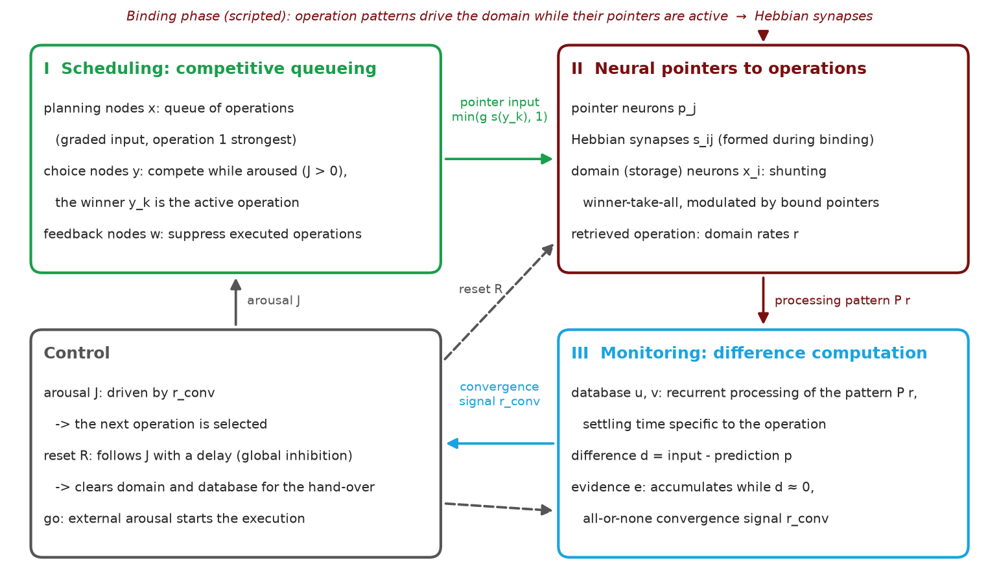
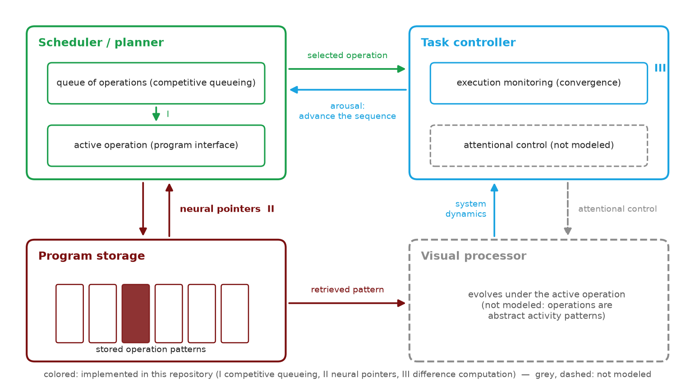
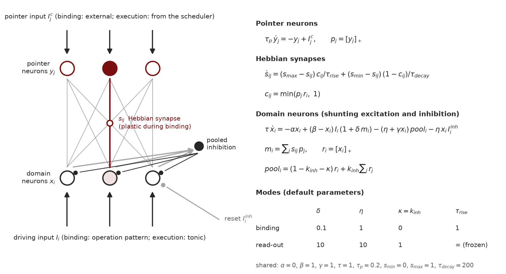
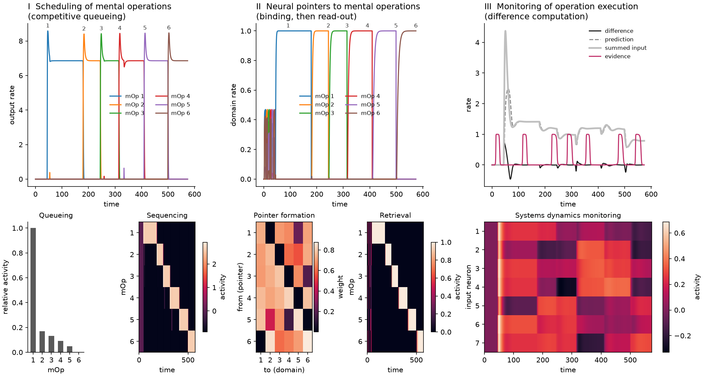
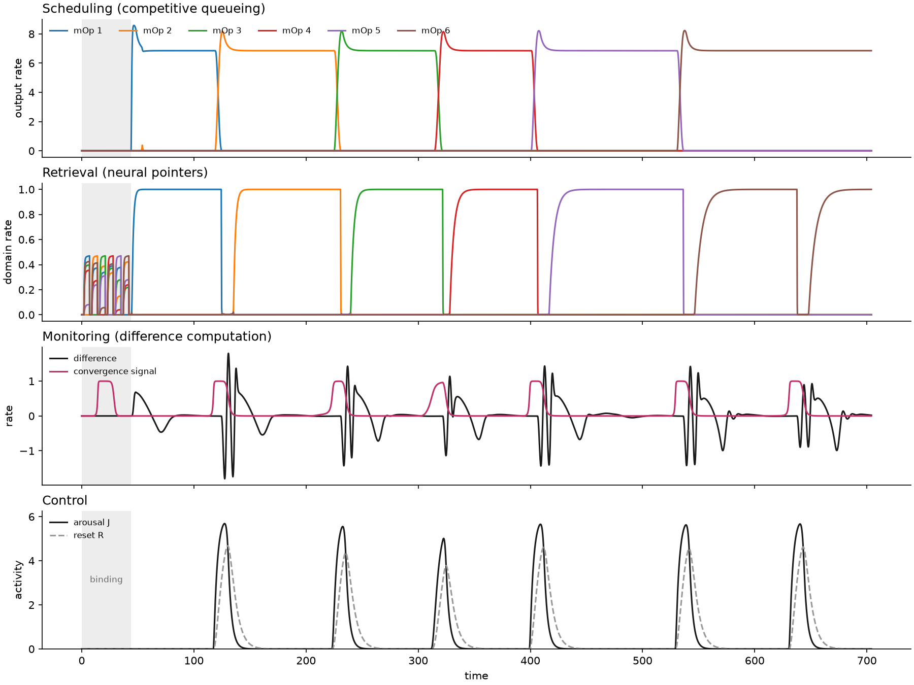
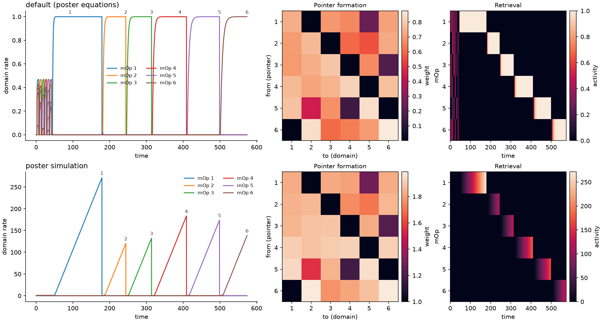

# Neural Pointers

Neurodynamical (rate-based) models for sequencing and executing visual-mental operations, accompanying the poster

> D. Schmid, C. Jarvers, H. Neumann. *A Neurodynamical Model of Sequencing and Executing Visual-Mental Operations.*
> Poster presented at the [7th BonnBrain³ Meeting](https://bonnbrain.de/7th-bonnbrain-meeting-19-21-08-2024-venusberg-campus-bonn-germany/),
> 19–21 August 2024, Bonn, Germany.

Cognitive tasks can be solved through the serial deployment of elemental mental operations (mental routines), which
are reusable, compositional and context-adaptive. This repository contains three model components of such a system:

| Component | Package | What it does |
|---|---|---|
| Synaptic neural pointers | `neural_pointers.pointers` | Pointer neurons are bound to patterns of domain activity by fast Hebbian plasticity and later re-instantiate the bound pattern via winner-take-all read-out (after Zylberberg et al., 2013). |
| Competitive queueing | `neural_pointers.competitive_queueing` | A graded activity pattern is executed item by item, gated by an arousal signal (after Boardman & Bullock, 1991). |
| Difference computation | `neural_pointers.monitoring` | A monitoring network accumulates evidence and signals when an input representation has settled, i.e. when an operation has finished. |
| Closed loop | `neural_pointers.coupled` | The three components execute a sequence of operations together. |

All models are systems of ordinary differential equations integrated with `scipy.integrate.odeint`. A simulation is a
sequence of *stages* (e.g. binding, reset, read-out), each with its own external inputs. The equations are documented
in the docstrings of the model classes.

Each component can be simulated on its own with a scripted protocol, and all three together in a closed loop in which
the convergence of one operation triggers the next one.

## Model



The implemented model: the competitive queueing network (I) schedules the operations, neural pointers (II) link the
selected sequence slot to the stored operation, and the monitoring network (III) signals when the processing of the
operation has settled, which advances the sequence via the control signals. Before the execution, the operations are
bound to the pointers in a scripted binding phase.

The components belong to the larger architecture for cognitive programs presented on the poster (redrawn below): a
scheduler holds the program as a queue of operations, neural pointers link its program interface to the stored
operation patterns, and the task controller monitors the execution. The repository implements the colored parts; the
visual processor and the attentional control are not modeled, so operations are represented by abstract activity
patterns.



The pointer mechanism and the equations of the default pointer model (see `SynapticPointerModel` for the derivation
of each term and `model=poster_simulation` for the structure used in the poster simulations):



## Results



The default simulations of the current version, arranged like the results panel of the poster (generated with
`python plot_overview.py`):

* **I Competitive queueing.** Top: output rates of six mental operations (mOps) that are executed one after another
  whenever the arousal signal is on. Bottom: activity of the input (planning) layer before the first operation is
  executed (*Queueing*) and output activity over time (*Sequencing*).
* **II Neural pointers.** Top: domain rates. In the first 44 time units, six input patterns are bound to six pointers
  (small activity at the start); afterwards each pointer is activated in turn and its bound pattern wins the read-out
  competition. Bottom: pointer-to-domain weights after binding (*Pointer formation*) and domain activity over time
  (*Retrieval*).
* **III Monitoring.** Top: the difference between the summed input and its prediction, which catches up with the
  input. Once the difference stays close to zero, the evidence neuron signals that the input representation has
  settled, once after each change of the input pattern. Bottom: activity of the input neurons over time (*Systems
  dynamics monitoring*).

### Closed-loop simulation



Six operations are first bound to six pointers (shaded). An external arousal pulse then starts the execution, and the
components run in a closed loop: the competitive queueing network selects an operation (*Scheduling*), its output
activates the pointer of the operation, which retrieves the operation in the pointer domain (*Retrieval*). The
retrieved operation is instantiated in the monitoring network's recurrent input layer (the database), which processes
the operation's pattern; once this processing has settled, the convergence signal (*Monitoring*) drives an arousal
neuron that makes the competitive queueing network select the next operation, and, with a delay, a reset neuron whose
global inhibition clears the pointer domain and the database for the next operation (*Control*). All six operations
are executed in order, each after one convergence signal. How long an operation executes is set by the settling time
of its own processing pattern: permuting which operation processes which pattern moves the durations along with the
patterns. Terminating a program is task-level control outside the model: once the queue is exhausted, the last
operation remains active in the competitive queueing network, so a longer execution stage would re-instantiate and
re-execute it with every further convergence signal. See `neural_pointers.coupled.model` for the equations.

### Variants of the pointer model



By default, the pointer model follows the model equations shown on the poster: shunting excitation and inhibition
bound the potentials, pointers are neurons with their own dynamics, and only bound pointer-domain pairs are coupled.
Each item is read out with saturated activity (top). The simulations shown on the poster used a simpler structure
(`model=poster_simulation`, bottom): additive excitation without leak lets the winner's activity grow linearly and
without bound during read-out, and every pointer modulates every domain neuron. This variant cannot drive the closed
loop: the unbounded retrieval saturates the monitoring input layer above the prediction ceiling, so the difference
settles at a positive value and convergence is never signaled, and plasticity during read-out re-binds the pointers
at the hand-over (see [docs/poster_differences.md](docs/poster_differences.md)). The sequence stops after the first
operation.

All figures of both variants (`python plot_overview.py`):

| Pointer model | Overview | Closed loop |
|---|---|---|
| default (poster equations) | [overview](docs/figures/default/overview.png) | [closed loop](docs/figures/default/coupled.png) |
| `poster_simulation` | [overview](docs/figures/poster_simulation/overview.png) | [closed loop](docs/figures/poster_simulation/coupled.png) |

## Installation

Python 3.10 or newer is required.

```bash
git clone <repository-url> neural-pointers
cd neural-pointers
pip install -e .
```

To use the exact package versions the reproduction tests were run with, install `pip install -r requirements.txt -e .`
instead.

## Usage

Each component has its own entry point and [Hydra](https://hydra.cc) configuration in `configs/<component>/`:

```bash
python run_pointers.py
python run_competitive_queueing.py
python run_monitoring.py
python run_coupled.py
```

Every run stores its resolved configuration, a log, `results.npz` (time points `t`, states `h`, `stage_names` and
`stage_lengths`; additionally `convergence_times` for the monitoring experiment) and figures in
`outputs/<component>/<date>/<time>/` (for the closed loop also the order of execution and the times of the convergence
signals).

Parameters can be overridden on the command line, and parameter sweeps run with `--multirun`, e.g.

```bash
python run_pointers.py plot=false model.WTA_params.neuron_params.delta=5.0
python run_pointers.py --multirun seed=1,2,3 plot=false
```

The structure of the pointer model is selected by `model.variant`; the structure used for the poster simulations is
available as a preset:

```bash
python run_pointers.py model=poster_simulation
```

Each configuration consists of the top-level `config.yaml` (seed, number of neurons, plotting), `model/` (model
parameters) and `simulation/` (time step and stage protocol). The closed loop is configured in `configs/coupled.yaml`,
which reuses the model configurations of the components and adds the coupling parameters. To define a new protocol, add a file to `simulation/`
and select it with `simulation=<name>`. The available stage names are listed in the respective `inputs.py`.

The components can also be used from Python:

```python
from hydra import compose, initialize_config_dir
from neural_pointers.pointers.experiment import run_experiment

with initialize_config_dir(version_base="1.3", config_dir="/abs/path/to/configs/pointers"):
    cfg = compose(config_name="config")
model, results = run_experiment(cfg)  # list of StageResult(name, t, h)
```

## Reproducing the poster

The code state that reproduces the poster simulations exactly is tagged `poster-bonnbrain2024`:

```bash
git checkout poster-bonnbrain2024
```

Later versions fix bugs and revise parts of the models, which changes some results (see [CHANGELOG.md](CHANGELOG.md)).
The effect of these changes can be inspected with `python tools/compare.py poster-bonnbrain2024 WORKTREE`, which
compares key quantities and the overview figures of two versions.

## Tests

The tests check the default simulations against stored reference trajectories:

```bash
pip install -e ".[dev]"
pytest
```

## Differences to the poster simulations

The models were revised after the poster: the released defaults fix bugs and complete the mechanisms, which changes
some results. [docs/poster_differences.md](docs/poster_differences.md) summarizes the differences and their measured
effects; the tag `poster-bonnbrain2024` holds the exact poster code.

## Repository layout

```
configs/                 Hydra configurations, one directory per component, coupled.yaml for the closed loop
neural_pointers/
  activations.py         activation functions shared by all models
  simulation.py          stage-wise integration and result storage
  <component>/
    model.py             ODE model
    inputs.py            external inputs per stage
    experiment.py        simulation of a full protocol
    visualization.py     figures
run_<component>.py       command line entry points (run_coupled.py for the closed loop)
plot_overview.py         figures in docs/figures/ (one directory per pointer model preset)
neural_pointers/diagram.py  schematics (closed loop, architecture, pointer mechanism)
tests/                   reproduction and unit tests, reference data in tests/data/
tools/compare.py         comparison of the results of two code versions
```

## References

* Boardman, I. & Bullock, D. (1991). A neural network model of serial order recall from short-term memory.
  *IJCNN-91-Seattle International Joint Conference on Neural Networks*, vol. 2, 879–884.
* Zylberberg, A. D., Paz, L., Roelfsema, P. R., Dehaene, S. & Sigman, M. (2013). A neuronal device for the control of
  multi-step computations. *Papers in Physics*, 5, 050006.

## Citing

If you use this code, please cite the poster referenced above; citation metadata for the software is provided in
[CITATION.cff](CITATION.cff).

## Contributing

Format the code with `black .` before committing. Docstrings follow the Google style.

## License

MIT, see [LICENSE](LICENSE).
